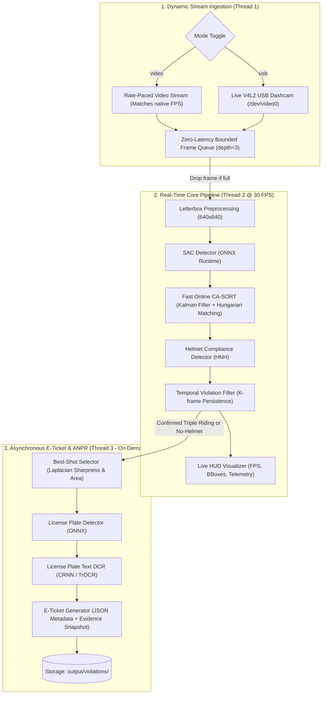

# DashCop Edge: Real-Time Traffic Violation Detection System

## Reference: Glossary of Acronyms & Full Forms

For quick reference, the following technical terms and acronyms are used throughout this document and codebase:

| Acronym | Full Form | Meaning / Function in DashCop Edge |
|---|---|---|
| **SAC** | **Segmentation and Cross-Association** | Deep learning module (YOLOv8-Seg) that detects riders, motorcycles, and generates cross-masks linking riders to bikes. |
| **CA-SORT** | **Cross-Association Simple Online and Realtime Tracking** | Multi-object tracking algorithm that jointly tracks motorcycles and their associated riders across video frames. |
| **SORT** | **Simple Online and Realtime Tracking** | Standard multi-object tracking framework combining Kalman filtering with bounding box association. |
| **HNH** | **Helmet / No-Helmet** | AI classification module that checks whether individual riders are compliant with safety helmet laws. |
| **TR** | **Triple Riding** | Traffic violation where three or more individuals ride a single two-wheeler simultaneously. |
| **ANPR** | **Automatic Number Plate Recognition** | Computer vision subsystem that locates vehicle license plates and extracts alphanumeric characters. |
| **ALPR** | **Automatic License Plate Recognition** | Alternative industry term synonymous with ANPR. |
| **OCR** | **Optical Character Recognition** | Technology that translates cropped image text (license plates) into editable alphanumeric string characters. |
| **CRNN** | **Convolutional Recurrent Neural Network** | Lightweight deep learning architecture used for sequence-based text/character recognition in ANPR. |
| **TrOCR** | **Transformer Optical Character Recognition** | Vision-transformer encoder-decoder model used for high-accuracy text recognition. |
| **YOLO** | **You Only Look Once** | Real-time single-stage convolutional object detection network family (YOLOv8 used here). |
| **ONNX** | **Open Neural Network Exchange** | Open-standard model format that enables cross-platform, hardware-accelerated model deployment. |
| **V4L2** | **Video4Linux2** | Linux kernel driver framework used for capturing video directly from USB/CSI cameras (`/dev/video0`). |
| **RTSP** | **Real-Time Streaming Protocol** | Network streaming protocol used to stream live video feeds over IP networks. |
| **HUD** | **Heads-Up Display** | Live visual graphical overlay projected on top of the camera video stream showing metrics and alerts. |
| **FPS** | **Frames Per Second** | Rate at which consecutive video frames are captured and processed by the system. |
| **IoU** | **Intersection over Union** | Evaluation metric calculating the overlap area between two bounding boxes divided by their union. |
| **RoI** | **Region of Interest** | Specific cropped sub-section of a video frame (e.g., rider head crop or license plate area). |
| **ILP** | **Integer Linear Programming** | Mathematical optimization method used in the original research paper (via Gurobi) to solve tracking trees. |
| **MWIS** | **Maximum Weight Independent Set** | Graph problem formulation solved via ILP in the original offline paper to prune conflicting tracking paths. |
| **LAP / LAPJV** | **Linear Assignment Problem (Jonker-Volgenant)** | Mathematical method (Hungarian algorithm) used in our Fast Online CA-SORT to match detections in polynomial time. |
| **WACV** | **Winter Conference on Applications of Computer Vision** | IEEE/CVF academic conference where the original DashCop research paper was published (WACV 2025). |
| **MOTA** | **Multiple Object Tracking Accuracy** | Standard multi-object tracking metric evaluating detection misses, false positives, and identity switches. |
| **IDF1** | **Identification F1 Score** | Tracking metric measuring how consistently object identity numbers are preserved over time. |
| **HOTA** | **Higher Order Tracking Accuracy** | Comprehensive tracking metric balancing detection accuracy and association accuracy. |
| **mAP** | **Mean Average Precision** | Standard accuracy metric for object detection and segmentation models across intersection thresholds. |

---

## 1. Executive Summary

**DashCop Edge** is a high-performance, real-time edge reimplementation of the research paper:
> *"DashCop: Automated E-ticket Generation for Two-Wheeler Traffic Violations Using Dashcam Videos"* (IEEE/CVF WACV 2025).

The original DashCop was built as an offline research prototype that required full video buffering, multi-pass processing, and a closed-source Integer Linear Programming (ILP) solver (Gurobi). 

**DashCop Edge transforms this into a real-time, single-pass edge-computing system** capable of sustaining **25–30+ FPS** on edge accelerators (e.g., NVIDIA Jetson Orin Nano/NX) and **15–20 FPS** on modern multi-core x86/ARM CPUs.

---

## 2. Key Architectural Innovations



### From Offline Research to Real-Time Edge
| Dimension | Original DashCop (WACV 2025) | DashCop Edge (This Project) |
|---|---|---|
| **Pipeline Style** | 2-pass offline batch processing | Single-pass streaming pipeline |
| **RAM Footprint** | Buffers all uncompressed frames in RAM ($>10\text{ GB}$) | Fixed circular ring buffer ($< 200\text{ MB}$) |
| **Tracking Engine** | Multi-hypothesis trees + Gurobi ILP MWIS | **Fast Online CA-SORT**: Kalman Filter + Hungarian Bipartite Matching ($< 1.5\text{ ms}$) |
| **Solver Dependency** | Proprietary commercial/academic Gurobi license | Zero external solver licenses (scipy / pure numpy) |
| **ANPR Inference** | Runs heavy TrOCR transformer on every frame | **Event-Driven Best-Shot**: Triggers OCR once per confirmed violation |
| **Model Runtime** | PyTorch Python loops with GPU-CPU transfers | Modular ONNX Runtime (CPU / CUDA / TensorRT) |
| **Input Flexibility** | Hardcoded file paths | Dynamic toggle: **Live USB Dashcam** $\leftrightarrow$ **Rate-Paced Video File** |

---

## 3. Modular System Architecture

### 3.1. Dynamic Ingestion Engine (`dashcop_edge.capture.StreamReader`)
- **Video Simulation Mode (`--mode video`)**: Reads pre-recorded dashcam MP4 files with millisecond rate-pacing so frames are processed in exact camera time (e.g. 30 FPS) rather than dumping frames as fast as disk I/O allows.
- **Live USB Camera Mode (`--mode usb`)**: Directly binds to V4L2 USB camera devices (`/dev/video0` or device index `0`) with low-latency buffering.
- **Congestion Handling**: Bounded queue (`maxsize=3`) automatically drops stale frames if the inference pipeline lags, ensuring the vehicle monitor always operates on the most current frame.

### 3.2. Fast Online CA-SORT Tracker (`dashcop_edge.tracker.OnlineCASORT`)
- **Kalman Filtering (`KalmanBoxTracker`)**: 7-state kinematic tracking vector $[x_c, y_c, s, r, \dot{x}_c, \dot{y}_c, \dot{s}]$ modeling position, bounding box area, aspect ratio, and linear velocities.
- **Class-Gated Spatial IoU**: High-dimensional association matrix that prevents cross-class identity switches between riders and motorcycles.
- **Cross-Association (Riders $\leftrightarrow$ Motorbikes)**: Dynamically binds each detected rider to their underlying motorbike using SAC cross-masks and spatial containment heuristics.
- **Linear Assignment**: Solves bipartite association in polynomial $O(N^3)$ time via the Hungarian algorithm (`scipy.optimize.linear_sum_assignment`), running in under $1.5\text{ ms}$.

### 3.3. Drop-in ONNX Runtime Engine (`dashcop_edge.models`)
- `OnnxModelSession` abstracts execution across CPU, CUDA, and TensorRT.
- **Strict Model Enforcement**: The system strictly validates the presence of all 4 required `.onnx` model files (`sac.onnx`, `hnh.onnx`, `lp_det.onnx`, `lp_ocr.onnx`) at startup. If any model file is missing from the `weights/` directory, the engine immediately prints a descriptive error detailing the missing file path and terminates execution.

### 3.4. Violation State Machine & Best-Shot E-Ticketing (`dashcop_edge.violations`)
- **Temporal Persistence Filter (`ViolationStateManager`)**: Prevents false alarms caused by single-frame detection noise. A violation is only confirmed if observed in at least $K$ consecutive frames (configurable, default: 5 frames).
- **Single Ticket per Vehicle Pass**: Tracks maintain violation lifecycle states (`ISSUED`) so a vehicle passing through the camera view generates exactly one citation ticket rather than spamming hundreds of duplicate records.
- **Best-Shot Sharpness Selector (`BestShotSelector`)**: Evaluates vehicle crops in a 15-frame circular buffer using Laplacian variance and bounding box area:
  $$\text{Quality Score} = \text{Variance}(\nabla^2 I) \times \sqrt{\text{Area}(I)}$$
  Selects the single sharpest, highest-resolution vehicle snapshot for plate recognition.
- **Asynchronous E-Ticket Dispatcher (`TicketDispatcher`)**: Decoupled background worker running license plate recognition (ANPR), generating formatted JSON violation records and saving high-resolution evidence snapshots into `output/violations/`.

---

## 4. Drop-in ONNX Weights Specification

When you finish training your custom models, place the `.onnx` files into the `weights/` directory:

| Filename | Purpose | Expected Input Tensor | Output Tensor |
|---|---|---|---|
| `weights/sac.onnx` | Segmentation & Cross-Association | `(1, 3, 640, 640)` | Bounding boxes `(N, 6)`, masks `(N, H, W)`, cross-masks `(N, H, W)` |
| `weights/hnh.onnx` | Helmet / No-Helmet Detection | `(1, 3, 128, 128)` (head crop) | Classification logits: `[no_helmet, helmet]` |
| `weights/lp_det.onnx` | License Plate Localization | `(1, 3, 320, 320)` (bike crop) | Plate bounding box `(x1, y1, x2, y2, conf)` |
| `weights/lp_ocr.onnx` | Plate Alphanumeric OCR | `(1, 3, 48, 160)` (plate crop) | Character sequence logits / tokens |

*Note: All 4 model files are required. If any file is missing, the system immediately throws an explicit error and halts.*

---

## 5. Project Directory Structure

```
DashCop_Recreated/
├── pyproject.toml                     # uv project configuration & dependencies
├── .python-version                    # Python version pin (3.12)
├── README.md                          # Quick start instructions
├── PROJECT_DESCRIPTION.md             # This comprehensive technical guide
├── configs/
│   └── edge_config.yaml               # Runtime parameters, thresholds, and toggles
├── src/
│   └── dashcop_edge/
│       ├── __init__.py                # Package root & lazy entrypoint
│       ├── config.py                  # Dataclass & YAML configuration loader
│       ├── visualizer.py              # Real-time OpenCV HUD visualizer
│       ├── main.py                    # Main CLI application
│       ├── capture/
│       │   ├── __init__.py
│       │   └── stream_reader.py       # Asynchronous rate-paced / USB video ingestion
│       ├── tracker/
│       │   ├── __init__.py
│       │   ├── kalman_box_tracker.py  # 7-state Kalman bounding box tracker
│       │   └── online_ca_sort.py      # Fast Online CA-SORT (No-Gurobi Hungarian tracker)
│       ├── models/
│       │   ├── __init__.py
│       │   ├── onnx_engine.py         # ONNX Runtime provider wrapper
│       │   ├── sac_detector.py        # SAC detector (YOLOv8-Seg with cross-masks)
│       │   ├── hnh_detector.py        # Helmet compliance detector
│       │   └── anpr_engine.py         # License plate detector & OCR
│       └── violations/
│           ├── __init__.py
│           ├── best_shot.py           # Laplacian sharpness quality selector
│           ├── state_manager.py       # Multi-frame temporal persistence state machine
│           └── ticket_dispatcher.py   # Asynchronous JSON/JPG E-ticket emitter
├── tests/
│   ├── test_config.py                 # Configuration unit tests
│   ├── test_stream_reader.py          # Ingestion & rate-pacing tests
│   ├── test_kalman_tracker.py         # Kalman filter numerical tests
│   ├── test_online_ca_sort.py         # Multi-class association tests
│   └── test_violations.py             # Temporal persistence & ticket tests
├── weights/
│   └── README.md                      # ONNX drop-in instructions and tensor shapes
├── output/
│   └── violations/                    # Generated E-Ticket JSON records & evidence JPGs
└── temp/                              # Preserved original upstream research files
```

---

## 6. Execution Guide

### 6.1. Environment Installation (when ready)
```bash
# Install core dependencies with uv
uv sync

# Optional: with GPU acceleration
uv sync --extra gpu
```

### 6.2. Running in Video File Mode (Rate-Paced Simulation)
Simulates a live dashcam stream from a pre-recorded file, pacing playback to match recording FPS:
```bash
uv run dashcop-edge --mode video --source data/sample.mp4 --display
```

### 6.3. Running in Live USB Dashcam Mode
Connects directly to an onboard USB camera:
```bash
uv run dashcop-edge --mode usb --source 0 --display
```

### 6.4. Running as a Headless Edge Daemon
For background edge deployment (e.g. on vehicle boot without an attached monitor):
```bash
uv run dashcop-edge --mode usb --source 0 --headless
```

---

## 7. Sample Generated E-Ticket Artifact

When a violation (e.g., triple riding or no helmet) is confirmed, the system automatically produces a structured JSON record accompanied by a high-resolution evidence snapshot in `output/violations/`:

```json
{
  "ticket_id": "TICKET_20261118_193500_TRK12_TRIPLE_RIDING",
  "timestamp": 1731936900.125,
  "datetime": "2026-11-18T19:35:00.125000",
  "frame_id": 412,
  "track_id": 12,
  "violation_type": "TRIPLE_RIDING",
  "num_riders": 3,
  "license_plate": {
    "number": "DL01AB5421",
    "confidence": 0.92
  },
  "bounding_box_xyxy": [180.5, 210.0, 310.2, 345.8],
  "evidence_image": "TICKET_20261118_193500_TRK12_TRIPLE_RIDING.jpg",
  "status": "ISSUED"
}
```
